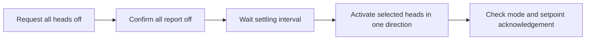

# House Climate

Coordinate rooms that share a heat pump's heating/cooling direction, using temperature probes and devices already connected to Home Assistant.

House Climate runs continuously inside HA as a custom integration. Configure rooms, sensors, comfort targets, schedules, priorities, and fans in **Settings → Devices & services → House Climate → Configure**. Everyday temperature adjustments use room thermostat cards and Desired temperature controls on your dashboard. No API token or separate container is needed for the native integration.

**Experimental, shadow mode by default.** The controller proposes decisions without sending device commands until live control is enabled. CI exercises simulated equipment and real HA APIs; physical equipment commissioning remains installation-specific.

## What it supports

- Any number of named rooms and heads on **one shared heat/cool system**.
- Multiple rooms sharing one head, without averaging away a hot or cold area.
- Multiple temperature sources, with freshness checks, median fusion, and persistent extreme detection.
- Per-room targets, priorities, daily schedules, and optional HA area assignments.
- Dashboard thermostat cards for comfort ranges, Desired temperature controls, and temporary holds that resume the schedule automatically.
- Cooling, conditioning, scheduled, continuous, and inter-room airflow fan rules.
- One optional auxiliary heater, thermostated by external room probes.
- A native device-page enable switch and independent watchdog; no YAML package for native room configurations.
- A readable device-page plan: room temperatures, head actions and comfort ranges, fan speeds, auxiliary heat, and current issues—including in shadow mode.
- The same engine as a Python CLI, Docker image, or HA add-on.

Room names are labels, not control roles. There are no required bedroom, office, or living-room names. A room's behavior comes entirely from its configuration.

## Install

Requires **Home Assistant 2026.10+** for the native integration.

Use the [installation guide](docs/hacs.md) to add this repository to HACS as an **Integration**, or install the manual ZIP.

1. Install the integration and restart HA.
2. Add **House Climate** in Devices & services.
3. Add your rooms, select their devices and sensors, and save in shadow mode.
4. Open the **House climate controller** device to see its **Plan summary**, room plans, temperatures, fan speeds, and current issues.
5. Verify equipment timing and the auxiliary heater setpoint, enable live commands in Configure, then turn on **Controller enabled** on the device. Native controls and the watchdog are included automatically.

Existing file-based installations continue to work. See [configuration and migration](docs/configuration.md) before moving their settings into the HA editor.

## How decisions work

The default temperature limits are **66–75°F** and can be changed. Actual limit violations outrank predicted limit pressure, which outranks room comfort priority and demand severity. Counting more rooms never outvotes a temperature limit.

Schedules override a room's base profile during their configured hours. They use HA's timezone, including daylight-saving changes, and may cross midnight. For example, a room can have a high sleep priority and a 60% scheduled fan overnight, then use only the system temperature limits during the day.

Every shared-system direction change follows this sequence:



Default direction dwell is 20 minutes, with two minutes of sustained competing demand. Actual limit violations may bypass the software dwell, but never the all-off settling interval. Missing room temperatures inhibit the associated head. A raw cold or hot reading blocks conditioning that would worsen the opposite limit.

The optional auxiliary heater uses an intentionally high device setpoint to call for heat, then explicit off commands at the external room thermostat's upper band. An independent HA watchdog monitors external probes and the controller heartbeat. A combined heater/fan is controlled through its climate entity alone.

Temperature bounds are control objectives, not physical guarantees. Conflicting demands, capacity, airflow, probe error, and communication failure can prevent the system from meeting them. See [control behavior and limitations](docs/control.md).

## Standalone use

Python 3.11+; the controller runtime uses the standard library.

```sh
cp config.example.toml config.local.toml
python -m house_climate --config config.local.toml check-config
python -m house_climate --config config.local.toml demo
```

Replace the synthetic entity IDs with your own. Set `HA_URL` and `HA_TOKEN` privately in the process environment, then run:

```sh
python -m house_climate --config config.local.toml run
```

Ordinary `run` is read-only. Use `generate-ha` to generate the enable/watchdog package; live operation requires both `--live` and the HA enable switch. Do not run more than one live controller.

[Add-on and Docker instructions](house_climate_addon/DOCS.md) cover the alternative deployment. The native HA editor configures the native integration; standalone/add-on configurations remain TOML files.

## Development

```sh
python -m venv .venv
.venv/bin/python -m pip install -e '.[test]'
.venv/bin/python -m unittest discover -s tests -v
```

Native integration tests use Python 3.14 and Home Assistant 2026.10.1. See [CONTRIBUTING.md](CONTRIBUTING.md) for tests, architecture, and release packaging.

[MIT license](LICENSE). [Changelog](CHANGELOG.md).
